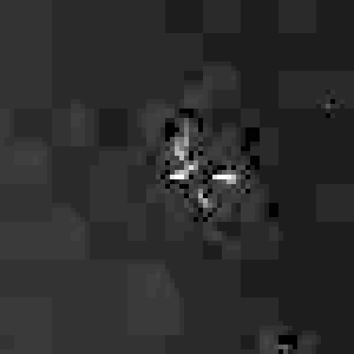
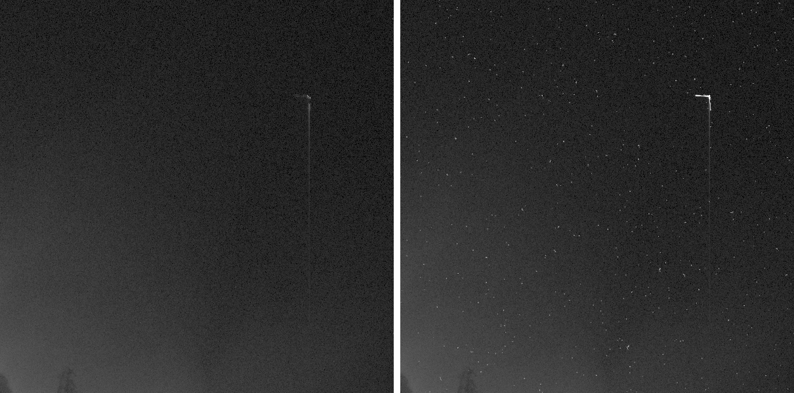
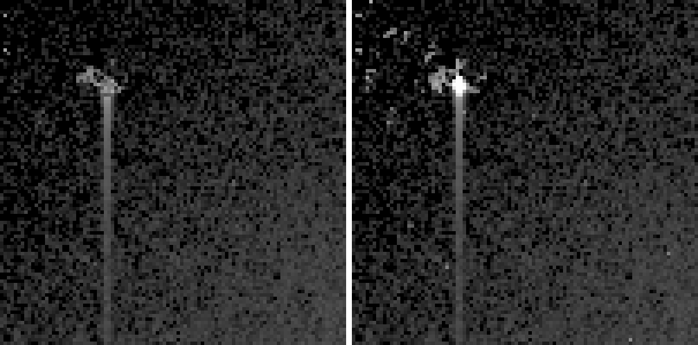
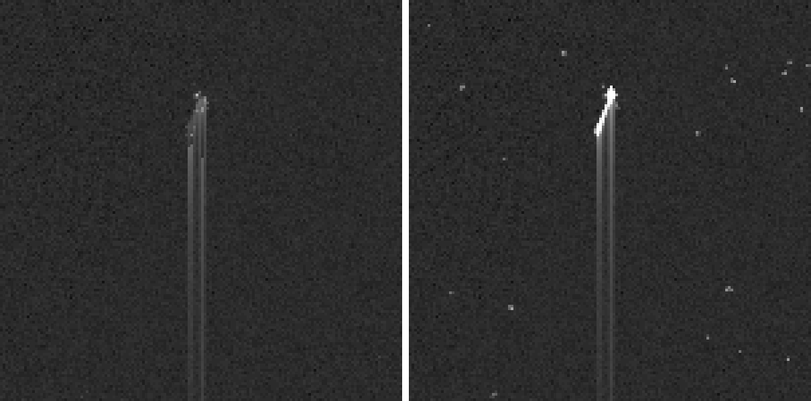
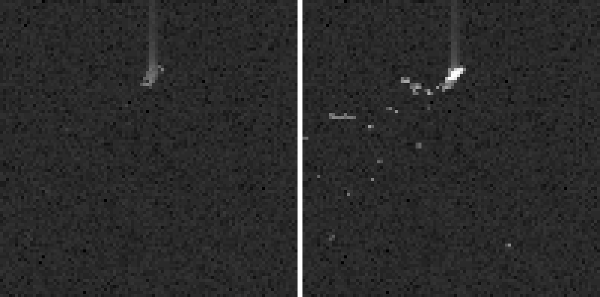

# Classification of Non-Solar Artifacts in Four STEREO/EUVI and SDO/AIA Browse Images

**Author:** MonkeeSage

**Date:** 2026-11-09

## Abstract

We examine five localized, non-solar features in four publicly available
extreme-ultraviolet (EUV) browse images of the Sun: one from the STEREO-A
EUVI 195 Å telescope (2010) and three from SDO/AIA (335 Å in 2013, 193 Å in
2017, and a 304/211/171 Å composite in 2019). We compare each feature with the
artifact taxonomy published by the STEREO Science Center (SSC) [[1](#ref-1)], check
whether it persists in neighbouring frames, and examine its morphology at
the pixel level. We then check each feature against the underlying science
data: the EUVI Level-0 frame, and the AIA Level-1 frames together with the
"spikes" files that record what the ground despiking removed. All five are
classified as **energetic-particle hits ("cosmic rays") on the CCD
detector**. The particle-hit pixels reach about 12,000–17,000 DN. The AIA
despiking removed 96–99 % of each hit's excess signal but left a faint
column trail, which is what appears in the browse images. The four AIA
trails run along detector columns, one-sided and away from the nearest
horizontal edge of the image. One hit's trails start separately from each
bright pixel of its track. This indicates charge spreading along columns
inside the detector rather than the particle's own path. We discuss
charge-transfer trailing as the most likely, but unconfirmed, mechanism.

## Contents

1. [Introduction](#1-introduction)
2. [Summary](#2-summary)
3. [Data](#3-data)
4. [Results](#4-results)
   - [A1 — STEREO-A EUVI 195 Å, 2010-04-25](#a1)
   - [A2 — SDO/AIA 335 Å, 2013-02-24](#a2)
   - [A3 — SDO/AIA 193 Å, 2017-06-20](#a3)
   - [A4a / A4b — SDO/AIA 304 Å composite, 2019-06-28](#a4)
5. [Discussion: why do the AIA hits have one-sided trails?](#5-discussion-why-do-the-aia-hits-have-one-sided-trails)
6. [Not objects near the Sun](#6-not-objects-near-the-sun)

[References](#references)

## 1. Introduction

Not every feature in a solar image is solar. The SSC lists nine artifact
classes for STEREO imagery [[1](#ref-1)]: beacon-compression artifacts [[2](#ref-2)],
stars/planets/comets [[3](#ref-3)], background-subtraction errors [[4](#ref-4)], cosmic rays
[[5](#ref-5)], spacecraft debris [[6](#ref-6)], camera and optics defects such as dust, fibers
and filter light leaks [[7](#ref-7)], spacecraft rolls [[8](#ref-8)], internal reflections [[9](#ref-9)],
and corrupted or blank images [[10](#ref-10)]. NASA's general guide to solar-imager
anomalies adds saturation *bleeding* along detector columns, flare
*blooming* and diffraction, and particle *banding* [[11](#ref-11)]. Most of these
classes also apply to SDO/AIA, which uses back-illuminated 4096×4096 CCDs
read out through four corner amplifiers [[12](#ref-12)–[14](#ref-14)].

Energetic particles, including solar energetic particles and galactic cosmic
rays, deposit charge as they pass through a detector. They usually affect a
single pixel, but at shallow angles of incidence they leave streaks over many
pixels [[5](#ref-5), [15](#ref-15)]. AIA records thousands of such hits per frame: a mean of
about 6,800 on 2017-02-28, peaking at about 27,000 [[15](#ref-15)]. Level-1 AIA data
are despiked on the ground with a neighbour-comparison algorithm, which is
tuned for single-pixel events [[15](#ref-15)].

## 2. Summary

| ID | Image | Classification | Confidence |
|----|-------|----------------|------------|
| A1 | EUVI 195 Å, 2010-04-25 | Cosmic ray / particle hit (compression-distorted) | 90–97 % |
| A2 | AIA 335 Å, 2013-02-24 | Particle hit with column trail | 92–98 % |
| A3 | AIA 193 Å, 2017-06-20 | Particle hit with column trail | 92–98 % |
| A4a | AIA 304 Å composite, 2019-06-28 (upper left) | Particle hit with column trail | 92–98 % |
| A4b | AIA 304 Å composite, 2019-06-28 (lower left) | Particle hit with column trail | 92–98 % |

Secondary finding (Section 5): the AIA trails are charge spread along
detector columns from the hit's brightest pixels, not part of the
particle's path (80–92 %). The specific mechanism, charge-transfer
trailing, is less certain (45–65 %).

**On the confidence intervals:** they are subjective credence ranges
based on the evidence in Sections 4 and 5, not statistical intervals from
repeated measurement. The lower bound reflects how well the evidence
supports the classification against the alternatives considered. The upper
bound reflects what is still unknown. All five features have now been
checked in the science data, not only the browse images. The remaining
uncertainty is mostly that no single exposure can rule out every rare
alternative.

## 3. Data

| ID | Instrument / channel | Observation (UT) | Image size | Artifact centre (x, y) px |
|----|----------------------|------------------|------------|---------------------------|
| A1 | STEREO-A SECCHI/EUVI 195 Å | 2010-04-25 11:10:30 | 2048² | (2009, 1069) |
| A2 | SDO/AIA 335 Å | 2013-02-24 23:01:40 | 4096² | head (3964, 910) |
| A3 | SDO/AIA 193 Å | 2017-06-20 12:56:17 | 4096² | head (32, 1265) |
| A4a | SDO/AIA 304 Å (red channel of 304/211/171 composite) | 2019-06-28 13:46:29 | 4096² | head (148, 778) |
| A4b | SDO/AIA 304 Å (red channel of 304/211/171 composite) | 2019-06-28 13:46:29 | 4096² | head (58, 3665) |

Pixel coordinates are measured from the top-left corner of the browse JPEG.
The EUVI filename contains `n4euA`, where the "4" marks a full-resolution
science image, not a beacon image [[2](#ref-2)], so beacon compression artifacts do
not apply.

**Method.**
1. Each feature was located in the full-resolution JPEG.
2. Its morphology was examined in nearest-neighbour enlargements.
3. Its direction and asymmetry were measured from column profiles.
4. Persistence was tested by comparing the same pixel region in the
   previous and next browse frames:
   - EUVI: 11:05:30 and 11:13:00
   - AIA 193: 12:41:17 and 13:09:41
   - AIA composite: 13:46:11 and 14:13:59 (filename times)
5. Each feature was then examined in the science data for the same
   exposure (Level-0 for EUVI, Level-1 plus spikes for AIA), as described
   below.

The 2013 AIA 335 Å image is no longer on the SDO website. It was retrieved
from the Internet Archive, which does not hold the neighbouring 335 Å
browse frames (22:47:16 and 23:17:28). A2's persistence was instead tested
with the Level-1 frames taken 12 s before and after.

For A1, the browse JPEG was also compared with the Level-0 FITS file for
the same exposure, which holds the unprocessed detector values and the
on-board processing history in its header [[20](#ref-20)]. Level-0 FITS
files are 2048×2048 unsigned 16-bit images stored bottom row first; the
coordinates quoted below are flipped to top-down for comparison with the
browse image.

For the AIA artifacts, the Level-1 image and spikes file for each exposure
were exported from the JSOC `aia.lev1_euv_12s` series [[21](#ref-21)]. The
header times match the browse images exactly. For A2 the 335 Å frames 12 s
before and after were exported too. Level-1 AIA images are despiked: pixels
judged to be particle hits are replaced with a value estimated from their
neighbours [[15](#ref-15)]. The companion spikes file is a 3×N array giving
each replaced pixel's flat index into the image, its original value, and
its replacement [[15](#ref-15), [22](#ref-22)]. We confirmed that the
replacement values match the Level-1 image at every listed index. Putting
the original values back ("respiking") recovers the hit as the detector
recorded it. Level-1 coordinates below are also top-down. They differ by a
few tens of pixels from the browse coordinates, because the browse images
are re-centred on the Sun.

Crops are square regions upscaled to 600×600 px with nearest-neighbour
sampling, so the original pixels are preserved without interpolation. A2
is shown at native 1:1 scale because its trail is about 490 px long. The
browse figures can be regenerated with
[`scripts/make_figures.sh`](scripts/make_figures.sh), the Level-0
figure with [`scripts/euvi_level0.py`](scripts/euvi_level0.py), and the
Level-1 figures and measurements with
[`scripts/aia_level1.py`](scripts/aia_level1.py). The FITS files used are
included in [`data/stereo/`](data/stereo) and [`data/aia/`](data/aia)
(about 48 MB), so the results can be reproduced without downloading them
again:

```sh
python3 -m venv .venv && .venv/bin/pip install astropy numpy pillow
./scripts/make_figures.sh
.venv/bin/python -I scripts/euvi_level0.py data/stereo/20100425_111030_n4euA.fts images/level0
.venv/bin/python -I scripts/aia_level1.py data/aia images/level1
```

## 4. Results

<span id="a1"></span>

### A1 — STEREO-A EUVI 195 Å, 2010-04-25 (middle-right green blob)

[](images/crops/A1_euvi195_2010-04-25.png)

*75×75 px region at (1972, 1032), shown at 8×.*
Full-size image: [images/originals/20100425_111030_n4euA_195.jpg](images/originals/20100425_111030_n4euA_195.jpg) ·
Location overview: [annotated](images/annotated/20100425_111030_n4euA_195_annotated.jpg) ·
Source: <https://stereo-ssc.nascom.nasa.gov/browse//2010/04/25/ahead/euvi/195/2048/20100425_111030_n4euA_195.jpg>

**Observations.**
- **Shape:** a cluster, about 25 px across, of very sharp, saturated
  (255) line segments a few pixels long, set at different angles in a
  roughly star-like pattern.
- **Location:** in the faint outer corona near the right edge of the
  field, far from any bright solar structure.
- **Sharpness:** much sharper than anything solar nearby. The
  surrounding background shows the blocky texture of wavelet compression.
- **Persistence:** **absent** from the frames 5 minutes before and
  2.5 minutes after.

[](images/level0/A1_euvi195_level0.png)

*Level-0 data for the same exposure: 75×75 px region at raw (1957, 1145),
log-stretched after subtracting the CCD bias, shown at 8×.*
Source: <https://stereo-ssc.nascom.nasa.gov/data/ins_data/secchi/L0/a/img/euvi/20100425/20100425_111030_n4euA.fts>

**Level-0 data.**
- **Same shape before ground processing:** the raw frame shows the same
  multi-armed pattern, in the same orientation, at raw (1994, 1182). The
  distortion is therefore already present in the data sent down from the
  spacecraft.
- **Brightest pixels in the frame:** the hit peaks at 16,382 DN, the
  maximum value in the whole image and higher than any pixel on the solar
  disk. The frame median is 758 DN. All three pixels within 10 DN of
  that maximum lie in this hit, on raw row 1182.
- **No on-board cosmic-ray removal:** the header records `COSMICS = 0`
  and `N_IMAGES = 1`. This was a single 8 s exposure that was not
  cosmic-ray scrubbed.
- **Heavy lossy compression:** the on-board processing steps were
  "IP Trim", "Divide by 2" and **ICER5** (`IP_PROG3 = 95`), with a
  compression factor of 27.2 (`COMPFACT`).

**Discussion.**
- **Ruled out:**
  - Dust on the CCD [[7](#ref-7)] and the COR2 fiber [[7](#ref-7)] are persistent and fixed
    on the detector.
  - Stars and planets [[3](#ref-3)] persist and drift slowly. EUVI also rarely
    records them.
  - Debris [[6](#ref-6)] appears as diffuse, out-of-focus blobs in coronagraphs,
    not as sharp in-focus pixels in the EUV imager.
  - Light leaks [[7](#ref-7)] are faint, extended streaks.
- **What fits:** a cosmic-ray hit, consistent with the SSC example
  images [[5](#ref-5)]. The fragmented, multi-armed shape matches the SSC note that
  "even the full resolution data have some compression applied to them,
  resulting in a small amount of distortion of the brightest cosmic
  rays" [[5](#ref-5)].
- **Compression:** almost all EUVI images are compressed on board with
  the ICER wavelet compressor [[16](#ref-16)]. A 2010 status report lists
  ICER3 as the usual 195 Å setting [[17](#ref-17)], but this frame's
  header shows the more aggressive ICER5 [[20](#ref-20)]. Lossy wavelet
  compression at this level is the most likely cause of both the armed,
  cross-like structure around the very bright hit and the blocky texture
  of the surrounding background.
- **Smoothing:** the browse-image smoothing that the SSC removed in July
  2011 [[5](#ref-5)] does not apply here, because EUVI's 2048² browse images are at
  native detector resolution [[18](#ref-18)].

**Classification:** Cosmic ray / energetic-particle hit, morphology
distorted by on-board compression.
**Confidence: 90–97 %.** The feature appears in one frame only, has
detector-scale sharpness, and matches SSC examples. The Level-0 data
shows that it holds the brightest pixels of the frame, in an exposure that
had no on-board cosmic-ray removal and heavy ICER5 compression. The
remaining doubt is that a single exposure cannot rule out every rare
alternative, such as a brief point-like glint from debris. Such an event
would be unusual for an EUV imager.

<span id="a2"></span>

### A2 — SDO/AIA 335 Å, 2013-02-24 (upper-right blue streak)

[](images/crops/A2_aia335_2013-02-24.png)

*600×600 px region at (3496, 860), native 1:1 scale. The dark feature at
the lower left of the crop is solar limb structure, not part of the artifact.*
Full-size image: [images/originals/20130224_230140_4096_0335.jpg](images/originals/20130224_230140_4096_0335.jpg) ·
Location overview: [annotated](images/annotated/20130224_230140_4096_0335_annotated.jpg) ·
Source: <https://web.archive.org/web/20250124020907if_/https://sdo.gsfc.nasa.gov/assets/img/browse/2013/02/24/20130224_230140_4096_0335.jpg>

**Observations.**
- **Head:** a short, hooked, saturated head about 15 px long.
- **Trail:** a faint trail 1–2 px wide running straight down a single
  column for about 490 px (y ≈ 910 → 1400).
- **Asymmetry:** within 50 px of the head, the signal below it is about
  4× the signal above it.
- **Location:** off-limb, in the dim corona.

[](images/level1/A2_level1_vs_respiked.png)

*Level-1 data for the same exposure, 600×600 px region at (3496, 765),
native scale. Left: Level-1 as distributed (despiked). Right: respiked with
the original values from the spikes file. Same log stretch for both. The
scattered dots on the right are ordinary single-pixel hits that despiking
removed.*
Data: JSOC `aia.lev1_euv_12s`, T_OBS 2013-02-24T23:01:40.078 [[21](#ref-21)]

**Level-1 and spikes data.**
- **The hit:** respiking shows an L-shaped track about 20 px long, with
  its head at Level-1 (3967, 915). Its brightest pixel originally held
  16,857 DN, at the ceiling of values found in the spikes files
  (≈16,000–17,800 DN). The coronal background here is about 2 DN.
- **Despiking:** 920 of the 930 pixels in the hit were flagged as spikes,
  removing 97 % of its excess signal. Even so, the brightest pixel left in
  the *entire* despiked frame (9,868 DN) is an unflagged pixel of this hit.
- **Trail:** in the respiked data the column below the head averages
  471 DN over the first 50 px, against 2 DN above it. Its brightness falls
  to half within about 14 px, leaving a faint tail. Despiking cut the near
  part of the trail to about 14 DN, and that residue is the streak seen in
  the browse image.
- **Persistence (12 s cadence):** in the frames 12 s before and after,
  no pixel within 20 px of the head exceeds 207 DN and 454 DN
  respectively. Those values are typical of ordinary single-pixel spikes.
  The whole-frame maxima of those frames are only 635 DN and 595 DN.

**Discussion.**
- **Head:** the hooked track is typical of a particle crossing the
  detector at a shallow angle [[5](#ref-5), [15](#ref-15)].
- **Comet:** ruled out. The feature is absent 12 s before and after, which
  no comet could do, and its tail points along a detector column rather
  than away from the Sun.
- **Persistent defect:** ruled out by the 12 s neighbours.
- **Saturation bleeding from a bright source:** ruled out. There is no
  solar source here; the bright pixels are the particle track itself. See
  Section 5 for the trail.

**Classification:** Energetic-particle hit with a column-direction trail.
**Confidence: 92–98 %.** The hit appears in one 2.9 s exposure only,
contains the brightest pixels of the frame, and was almost entirely
flagged by the AIA despiking algorithm, which was designed to find
particle hits.

<span id="a3"></span>

### A3 — SDO/AIA 193 Å, 2017-06-20 (upper-left orange blob and streak)

[](images/crops/A3_aia193_2017-06-20.png)

*100×100 px region at (0, 1225), shown at 6×.*
Full-size image: [images/originals/20170620_125617_4096_0193.jpg](images/originals/20170620_125617_4096_0193.jpg) ·
Location overview: [annotated](images/annotated/20170620_125617_4096_0193_annotated.jpg) ·
Source: <https://sdo.gsfc.nasa.gov/assets/img/browse/2017/06/20/20170620_125617_4096_0193.jpg>

**Observations.**
- **Head:** an irregular, multi-pixel head about 14 px wide.
- **Trail:** a trail about 35 px long running straight down the column.
- **Asymmetry:** within 50 px, the signal below the head is about 26×
  the signal above it.
- **Location:** in the empty sky beyond the corona, near the left edge
  of the image.
- **Persistence:** **absent** from the frames 15 minutes before and
  13 minutes after.

[](images/level1/A3_level1_vs_respiked.png)

*Level-1 data for the same exposure, 100×100 px region at (0, 1239), shown
at 6×. Left: Level-1 as distributed (despiked). Right: respiked.*
Data: JSOC `aia.lev1_euv_12s`, T_OBS 2017-06-20T12:56:17.843 [[21](#ref-21)]

**Level-1 and spikes data.**
- **The hit:** respiking shows a single very bright point at Level-1
  (30, 1264), surrounded by a small splash of fainter pixels. The point
  originally held 17,051 DN, at the spikes-file ceiling. The local
  background is about 23 DN.
- **Despiking:** 73 of the 111 hit pixels were flagged, removing 96 % of
  the excess signal. The head was cut to 441 DN.
- **Trail:** the trail survives despiking almost unchanged: about 27 DN
  respiked and 24 DN despiked, averaged over the first 50 px below the
  head, against 3 DN above it. Its brightness falls to half within about
  18 px and to 10 % by about 66 px.

**Classification:** Energetic-particle hit with a column-direction trail.
**Confidence: 92–98 %.**

<span id="a4"></span>

### A4a / A4b — SDO/AIA 304/211/171 composite, 2019-06-28 (upper-left and lower-left red blobs and streaks)

[](images/crops/A4a_aia304_2019-06-28_upper.png)

*A4a: 150×150 px region at (73, 755), shown at 4×.*

[](images/crops/A4b_aia304_2019-06-28_lower.png)

*A4b: 100×100 px region at (8, 3600), shown at 6×.*

Full-size image: [images/originals/20190628_140035_4096_304211171.jpg](images/originals/20190628_140035_4096_304211171.jpg) ·
Location overview: [annotated](images/annotated/20190628_140035_4096_304211171_annotated.jpg) ·
Source: <https://sdo.gsfc.nasa.gov/assets/img/browse/2019/06/28/20190628_140035_4096_304211171.jpg>

**Observations.**
- **A4a:** a head at (148, 778) with a trail about 110 px long running
  *down* the column. Within 50 px, the signal below the head is about
  100× the signal above it.
- **A4b:** a head at (58, 3665) with a trail about 35 px long running
  *up* the column. Within 50 px, the signal above the head is about 13×
  the signal below it.
- **Channel:** both features are purely red. They appear only in the
  304 Å channel, which the image label shows was exposed 8 s after the
  211 Å and 171 Å exposures (13:46:29 vs 13:46:21).
- **Persistence:** both are **absent** from the frames about 14 minutes
  before and after.

[](images/level1/A4a_level1_vs_respiked.png)

*A4a in Level-1 data, 150×150 px region at (91, 779), shown at 4×. Left:
despiked. Right: respiked.*

[](images/level1/A4b_level1_vs_respiked.png)

*A4b in Level-1 data, 100×100 px region at (33, 3680), shown at 6×. Left:
despiked. Right: respiked.*
Data: JSOC `aia.lev1_euv_12s` 304 Å, DATE-OBS 2019-06-28T13:46:29.129,
the time printed on the browse image [[21](#ref-21)]

**Level-1 and spikes data.**
- **A4a:** respiking shows a straight diagonal track about 15 px long,
  with its head at Level-1 (166, 816) and a peak of 11,874 DN. Despiking
  removed 99 % of its excess signal. What remains (890 DN) is still the
  brightest pixel in the entire despiked 304 Å frame. **Several parallel
  trails** run down the columns, each starting from a different bright
  pixel along the track. Over the first 50 px below the head they average
  914 DN respiked and 22 DN despiked.
- **A4b:** respiking shows a bright compact blob at Level-1 (83, 3705),
  peaking at 16,069 DN, with a spray of fainter flagged pixels below and
  to its left. Despiking removed 99 % of its excess signal. Its trail runs
  *up* the column and is fainter: about 4 DN above the head versus 1 DN
  below it, over 50 px. Its brightness falls to half within about 21 px.

**Discussion.**
- **Rules out a real source:** a real off-limb source would appear in
  the overlapping coronal channels as well. A feature that appears in
  only one channel and only one frame is characteristic of a hit on one
  camera during one exposure.
- **Confirmed in the science data:** both features are particle-hit
  pixels at thousands of DN on a background near 0 DN. The despiking
  algorithm flagged both as spikes.

**Classification (both):** Energetic-particle hits with column-direction trails.
**Confidence: 92–98 %.**

## 5. Discussion: why do the AIA hits have one-sided trails?

Ordinary particle tracks point in random directions. All four AIA features
instead have a trail **along the column (vertical) axis**, and in each
case the trail points **toward the horizontal mid-line of the image**:

| ID | Head y (px) | Image half | Trail direction |
|----|-------------|------------|-----------------|
| A2 | 910 | top | down |
| A3 | 1265 | top | down |
| A4a | 778 | top | down |
| A4b | 3665 | bottom | up |

If all four trail directions were independent and random, a pattern this
consistent would be unlikely. The Level-1 data adds three further
observations:

1. **The trails are not part of the particle's path.** In A4a the track
   itself is a ~15 px diagonal, yet several separate trails run straight
   down the columns, one from each bright pixel along it (see the A4a
   figure). A particle crossing the detector leaves one track in one
   direction. Column-aligned trails starting at each bright pixel point
   instead to charge from those pixels spreading along the columns inside
   the detector.
2. **The trails start at the brightest pixels.** Three of the four heads
   (A2, A3 and A4b) reached 16,000–17,000 DN, the highest values recorded
   anywhere in the spikes files. That is consistent with saturated pixels.
3. **Each trail is bright near the head and fades quickly.** In the
   respiked data each trail falls to half its brightness within 10–21 px
   of the head, then continues as a faint tail. In the despiked data the
   bright near part is largely removed, but the faint tail survives
   because the despiking algorithm compares each pixel with its eight
   neighbours [[15](#ref-15)], and a smooth trail does not stand out from
   them. This explains why A2's trail looks about 490 px long in the
   browse image while most of its signal lies in the first 20 px.

**What the browse images are made from.** For the 2017 and 2019 images,
at most 6 % of the isolated single-pixel spikes near each artifact are
visible in the browse JPEG, against a chance baseline of 0 %. Those browse
images were therefore made from despiked Level-1 data, and what they show
of each artifact is the residue that despiking left. The 2013 browse image
shows 37 % of nearby spikes, against a chance baseline of 18 %. It
therefore appears to have been made from data that was not despiked, or
not fully.

**Mechanism.** Two detector effects spread charge along columns:
- **Saturation bleeding** [[11](#ref-11)]: charge overflowing a full
  pixel spills into its column neighbours. It is usually described as
  extending both ways along the column.
- **Charge-transfer inefficiency (CTE) trailing**: radiation-damage traps
  capture part of a bright charge packet during readout and release it
  later into pixels farther from the readout register [[19](#ref-19)].

The AIA CCD is split into four 2048×2048 quadrants, each read out through
its own corner amplifier [[14](#ref-14)]. If the parallel transfer runs
toward the top edge in the upper half and toward the bottom edge in the
lower half, then every trail here lies on the side *away from* its readout
register. That is the CTE signature, and a one-sided pattern like this is
hard to explain by bleeding alone. A CTE tail also has the observed shape:
bright just behind the source, then a long faint tail.

The CTE explanation remains unconfirmed because we have not verified
that the Level-1 orientation (which matches the browse orientation to
within a few tens of pixels) matches the readout direction of each AIA
camera. Level-1 processing does not resample the image relative to
Level-0 [[15](#ref-15), [22](#ref-22)], but we found no source documenting how Level-0
rows map to the CCD's readout registers.

**Confidence that the trails are charge spread along detector columns
from the hit's brightest pixels, rather than part of the particle tracks:
80–92 %.** **Confidence that the specific mechanism is CTE trailing:
45–65 %.** Neither changes the primary classification of any feature.

The EUVI hit (A1) shows no such trail. Its distortion is better explained
by on-board ICER compression [[5](#ref-5), [16](#ref-16), [20](#ref-20)].

## 6. Not objects near the Sun

Features like these are regularly mistaken for real objects near the Sun,
and sometimes promoted as UFOs or alien spacecraft. In 2003 the SOHO team
responded to such claims with a tongue-in-cheek guide to making a "UFO".
The guide enlarges and smooths one of the cosmic-ray marks found in almost
every SOHO EUV image into a saucer [[23](#ref-23)]. In 2012 a "jointed
spaceship" in a SOHO/LASCO C2 image was identified by the Naval Research
Laboratory as "merely a collection of streaks left by cosmic rays",
pointing out that "these artifacts do not persist from image to image"
[[24](#ref-24)]. Other artifact classes are misread the same way. A
geometric "object" in STEREO HI2-B data in December 2011 turned out to be
an internal reflection of Venus [[25](#ref-25)], and corrupted images can
superimpose data from different telescopes [[10](#ref-10)].

Five independent lines of evidence show that the features studied here
are energetic-particle hits rather than objects in space:

1. **They exist for a single exposure.** A2 is absent from the frames
   12 s before and after; the others are absent minutes before and after.
   A real object moves continuously and appears in consecutive frames, as
   comets do in SOHO and STEREO images [[3](#ref-3), [23](#ref-23)].
   A particle hit lasts only for the exposure in which it strikes.
2. **They are sharper than the telescope can image.** Anything in the sky
   is seen through the telescope optics, which blur a point to about
   1.5 arcsec, roughly 2.5 AIA pixels [[12](#ref-12)]. In A2, A4a and
   A4b the brightness falls from 11,900–16,900 DN to under 210 DN between
   one pixel and the next. Only charge deposited directly in the detector
   can have edges that sharp.
3. **They follow the detector, not the sky.** All four AIA trails run
   exactly along detector columns, and in A4a several trails start
   separately from each bright pixel (Section 5). A physical object would
   have no reason to line up with the pixel grid.
4. **They appear in one camera only.** The A4 features are in the 304 Å
   exposure but not in the 211 Å and 171 Å exposures taken 8 s earlier
   with an overlapping field of view.
5. **They are what particle hits look like, and they are common.** The
   AIA despiking algorithm, built to recognise particle hits, flagged 96–99 %
   of the signal in each feature. The same frames each contain between
   15,713 and 51,876 flagged spikes [[21](#ref-21)], so a few large ones
   in any image are expected.

Taken literally, the features would also be implausibly large. One AIA
pixel spans about 435 km at the Sun's distance (0.6 arcsec at 1 AU), so
A2's browse-image trail of about 490 px would be an object roughly
210,000 km long, about 15 % of the Sun's diameter, if it were near the Sun.

## References

1. <span id="ref-1"></span>STEREO Science Center, "Image artifacts." <https://stereo-ssc.nascom.nasa.gov/artifacts/artifacts.shtml>
2. <span id="ref-2"></span>STEREO Science Center, "Image artifacts – Beacon data." <https://stereo-ssc.nascom.nasa.gov/artifacts/artifacts_beacon.shtml>
3. <span id="ref-3"></span>STEREO Science Center, "Image artifacts – Stars, planets, and comets." <https://stereo-ssc.nascom.nasa.gov/artifacts/artifacts_planets.shtml>
4. <span id="ref-4"></span>STEREO Science Center, "Image artifacts – Background subtraction." <https://stereo-ssc.nascom.nasa.gov/artifacts/artifacts_background.shtml>
5. <span id="ref-5"></span>STEREO Science Center, "Image artifacts – Cosmic rays." <https://stereo-ssc.nascom.nasa.gov/artifacts/artifacts_cosmic_rays.shtml>
6. <span id="ref-6"></span>STEREO Science Center, "Image artifacts – Debris." <https://stereo-ssc.nascom.nasa.gov/artifacts/artifacts_debris.shtml>
7. <span id="ref-7"></span>STEREO Science Center, "Image artifacts – Telescope and camera defects." <https://stereo-ssc.nascom.nasa.gov/artifacts/artifacts_camera.shtml>
8. <span id="ref-8"></span>STEREO Science Center, "Image artifacts – Spacecraft rolls." <https://stereo-ssc.nascom.nasa.gov/artifacts/artifacts_rolls.shtml>
9. <span id="ref-9"></span>STEREO Science Center, "Image artifacts – Internal reflections." <https://stereo-ssc.nascom.nasa.gov/artifacts/artifacts_reflections.shtml>
10. <span id="ref-10"></span>STEREO Science Center, "Image artifacts – Corrupted and blank images." <https://stereo-ssc.nascom.nasa.gov/artifacts/artifacts_corrupted.shtml>
11. <span id="ref-11"></span>Hill, S. (2019), "Artifacts and Other Imaging Anomalies Taken by NASA's Solar Imagers," NASA *The Sun Spot* blog. <https://science.nasa.gov/blogs/the-sun-spot/2019/02/08/artifacts-and-other-imaging-anomalies-taken-by-nasas-solar-imagers/>
12. <span id="ref-12"></span>Lemen, J. R., Title, A. M., Akin, D. J., Boerner, P. F., et al. (2012), "The Atmospheric Imaging Assembly (AIA) on the Solar Dynamics Observatory (SDO)," *Solar Physics* 275, 17–40. <https://doi.org/10.1007/s11207-011-9776-8>
13. <span id="ref-13"></span>Boerner, P., Edwards, C., Lemen, J., Rausch, A., et al. (2012), "Initial Calibration of the Atmospheric Imaging Assembly (AIA) on the Solar Dynamics Observatory (SDO)," *Solar Physics* 275, 41–66. <https://doi.org/10.1007/s11207-011-9804-8>
14. <span id="ref-14"></span>Clapp, M., Lang, J., Pool, P., Morris, D., et al. (2017), "Systems approach to the design of the CCD sensors and camera electronics for the AIA and HMI instruments on Solar Dynamics Observatory," *Proc. SPIE* 10565 (ICSO 2010). <https://doi.org/10.1117/12.2309196>
15. <span id="ref-15"></span>Young, P. R., Viall, N. M., Kirk, M. S., Mason, E. I., Chitta, L. P. (2021), "An Analysis of Spikes in Atmospheric Imaging Assembly (AIA) Data," *Solar Physics* 296, 181. <https://doi.org/10.1007/s11207-021-01929-8> (arXiv: <https://arxiv.org/abs/2108.02624>)
16. <span id="ref-16"></span>Wuelser, J.-P., et al. (2007), EUVI status presentation, STEREO Science Working Group, March 2007. <https://stereoftp.nascom.nasa.gov/meetings/SWG/SWG_Mar_2007/wuelser/swg.pdf>
17. <span id="ref-17"></span>Howard, R. A. (2010), SECCHI status report, STEREO Science Working Group, 23 March 2010. <https://stereo.nascom.nasa.gov/meetings/SWG/SWG_Mar_2010/swg_secchi_status_20100323_howard.pdf>
18. <span id="ref-18"></span>Wuelser, J.-P., Lemen, J. R., Tarbell, T. D., Wolfson, C. J., et al. (2004), "EUVI: the STEREO-SECCHI extreme ultraviolet imager," *Proc. SPIE* 5171, 111. <https://doi.org/10.1117/12.506877>; see also Howard, R. A., et al. (2008), "Sun Earth Connection Coronal and Heliospheric Investigation (SECCHI)," *Space Science Reviews* 136, 67–115. <https://doi.org/10.1007/s11214-008-9341-4>
19. <span id="ref-19"></span>Townsley, L. K., Broos, P. S., Nousek, J. A., Garmire, G. P. (2002), "Modeling charge transfer inefficiency in the Chandra Advanced CCD Imaging Spectrometer," *Nuclear Instruments and Methods in Physics Research A* 486, 751–784. <https://doi.org/10.1016/S0168-9002(01)02156-8>
20. <span id="ref-20"></span>STEREO Science Center, SECCHI Level-0 data archive, EUVI-A file `20100425_111030_n4euA.fts`. <https://stereo-ssc.nascom.nasa.gov/data/ins_data/secchi/L0/a/img/euvi/20100425/20100425_111030_n4euA.fts>
21. <span id="ref-21"></span>Joint Science Operations Center (JSOC), Stanford University, SDO/AIA data series `aia.lev1_euv_12s`, image and spikes segments for records 78809615, 78809622 and 78809629 (335 Å, 2013-02-24), 157692406 (193 Å, 2017-06-20) and 194794212 (304 Å, 2019-06-28). Exported via <http://jsoc.stanford.edu/ajax/exportdata.html>
22. <span id="ref-22"></span>aiapy documentation, `aiapy.calibrate.respike`. <https://aiapy.readthedocs.io/en/stable/api/aiapy.calibrate.respike.html>
23. <span id="ref-23"></span>Boyle, A. (2003), "Scientists show how to make a UFO," msnbc.com / NBC News, 24 January 2003. <https://www.nbcnews.com/id/wbna3077760>
24. <span id="ref-24"></span>Wolchover, N. (2012), "UFO Spaceship Orbiting the Sun, or a Camera Glitch?," Life's Little Mysteries / Live Science, republished by NBC News, 26 April 2012. <https://www.nbcnews.com/news/amp/wbna47190227>
25. <span id="ref-25"></span>STEREO Science Center, "Triangular shaped object in STEREO data explained." <https://stereo-ssc.nascom.nasa.gov/artifacts/triangle/index.shtml>
