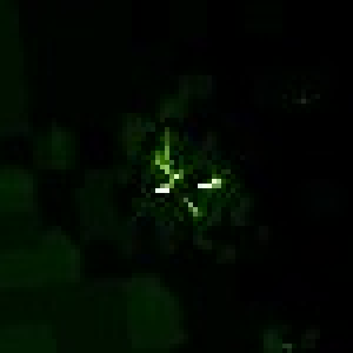
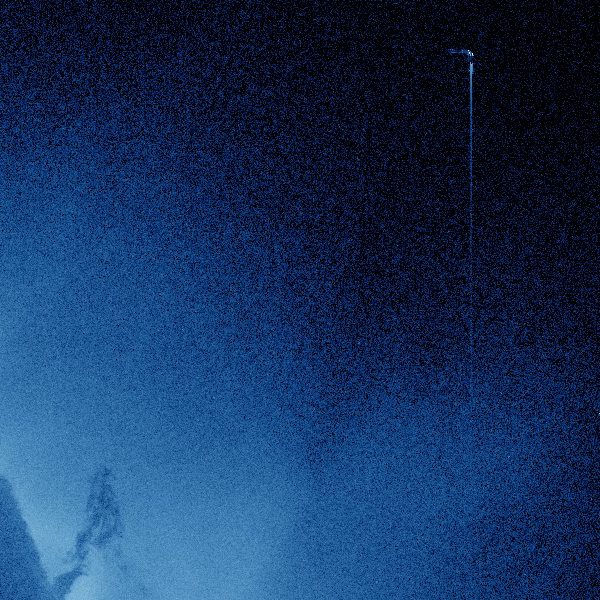
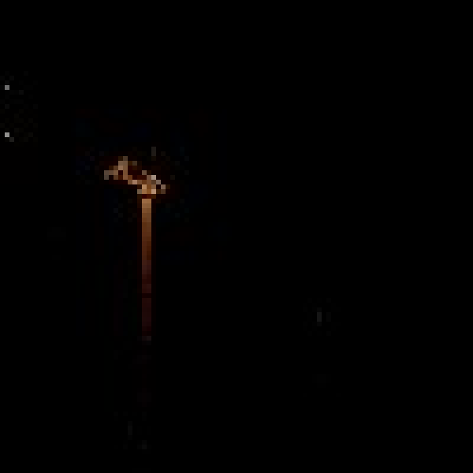
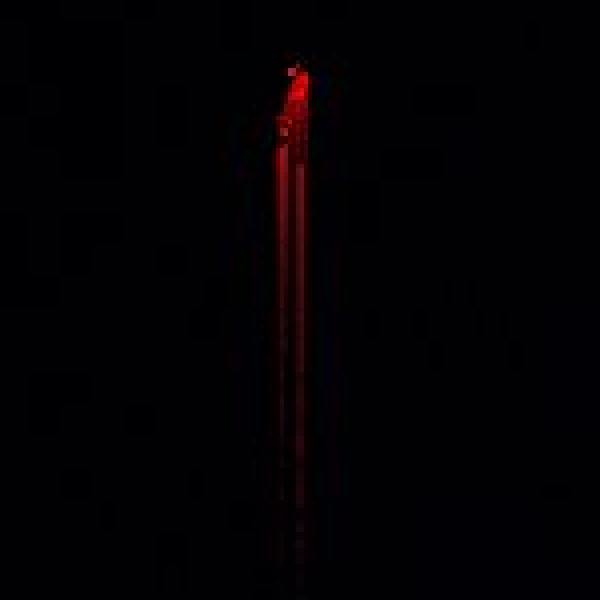
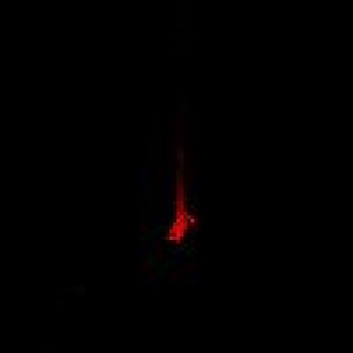

# Classification of Non-Solar Artifacts in Four STEREO/EUVI and SDO/AIA Browse Images

**Author:** MonkeeSage &lt;monkeesage@gmail.com&gt;
**Date:** 2026-11-09

## Abstract

We examine five localized, non-solar features in four publicly available
extreme-ultraviolet (EUV) browse images of the Sun: one from the STEREO-A
EUVI 195 Å telescope (2010) and three from SDO/AIA (335 Å in 2013, 193 Å in
2017, and a 304/211/171 Å composite in 2019). We compare each feature with the
artifact taxonomy published by the STEREO Science Center (SSC) [1], check
whether it persists in neighbouring frames, and examine its morphology at
the pixel level. All five are classified as **energetic-particle hits
("cosmic rays") on the CCD detector**. The four AIA features share an
unusual secondary property: each consists of a compact "head" with a faint
trail running along the detector column direction. In all four cases the
trail points away from the nearest horizontal edge of the image. We discuss
charge-transfer trailing as a possible but unconfirmed cause of this trail.

## 1. Introduction

Not every feature in a solar image is solar. The SSC lists nine artifact
classes for STEREO imagery [1]: beacon-compression artifacts [2],
stars/planets/comets [3], background-subtraction errors [4], cosmic rays
[5], spacecraft debris [6], camera and optics defects such as dust, fibers
and filter light leaks [7], spacecraft rolls [8], internal reflections [9],
and corrupted or blank images [10]. NASA's general guide to solar-imager
anomalies adds saturation *bleeding* along detector columns, flare
*blooming* and diffraction, and particle *banding* [11]. Most of these
classes also apply to SDO/AIA, which uses back-illuminated 4096×4096 CCDs
read out through four corner amplifiers [12–14].

Energetic particles, including solar energetic particles and galactic cosmic
rays, deposit charge as they pass through a detector. They usually affect a
single pixel, but at shallow angles of incidence they leave streaks over many
pixels [5, 15]. AIA records thousands of such hits per frame: a mean of
about 6,800 on 2017-02-28, peaking at about 27,000 [15]. Level-1 AIA data
are despiked on the ground with a neighbour-comparison algorithm, which is
tuned for single-pixel events [15].

## 2. Data

| ID | Instrument / channel | Observation (UT) | Image size | Artifact centre (x, y) px |
|----|----------------------|------------------|------------|---------------------------|
| A1 | STEREO-A SECCHI/EUVI 195 Å | 2010-04-25 11:10:30 | 2048² | (2009, 1069) |
| A2 | SDO/AIA 335 Å | 2013-02-24 23:01:40 | 4096² | head (3964, 910) |
| A3 | SDO/AIA 193 Å | 2017-06-20 12:56:17 | 4096² | head (32, 1265) |
| A4a | SDO/AIA 304 Å (red channel of 304/211/171 composite) | 2019-06-28 13:46:29 | 4096² | head (148, 778) |
| A4b | SDO/AIA 304 Å (red channel of 304/211/171 composite) | 2019-06-28 13:46:29 | 4096² | head (58, 3665) |

Pixel coordinates are measured from the top-left corner of the browse JPEG.
The EUVI filename contains `n4euA`, where the "4" marks a full-resolution
science image, not a beacon image [2], so beacon compression artifacts do
not apply.

**Method.**
1. Each feature was located in the full-resolution JPEG.
2. Its morphology was examined in nearest-neighbour enlargements.
3. Its direction and asymmetry were measured from column profiles.
4. Persistence was tested by comparing the same pixel region in the
   previous and next browse frames:
   - EUVI: 11:05:30 and 11:13:00
   - AIA 193: 12:41:17 and 13:09:41
   - AIA composite: 13:46:11 and 14:13:59 (filename times)

The 2013 AIA 335 Å image is no longer on the SDO website. It was retrieved
from the Internet Archive, which does not hold the neighbouring 335 Å
frames (22:47:16 and 23:17:28), so A2 could not be tested for persistence.

Crops are square regions upscaled to 600×600 px with nearest-neighbour
sampling, so the original pixels are preserved without interpolation. A2
is shown at native 1:1 scale because its trail is about 490 px long. All
figures can be regenerated with [`scripts/make_figures.sh`](scripts/make_figures.sh).

## 3. Results

### A1 — STEREO-A EUVI 195 Å, 2010-04-25 (middle-right green blob)

*75×75 px region at (1972, 1032), shown at 8×.*
Full-size image: [images/originals/20100425_111030_n4euA_195.jpg](images/originals/20100425_111030_n4euA_195.jpg) ·
Location overview: [annotated](images/annotated/20100425_111030_n4euA_195_annotated.jpg) ·
Source: <https://stereo-ssc.nascom.nasa.gov/browse//2010/04/25/ahead/euvi/195/2048/20100425_111030_n4euA_195.jpg>

**Observations.**
- **Shape:** a cluster, about 25 px across, of very sharp, saturated
  (255) line segments a few pixels long, set at different angles in a
  roughly star-like pattern.
- **Location:** in the faint outer corona near the right edge of the
  field, far from any bright solar structure.
- **Sharpness:** much sharper than anything solar nearby. The
  surrounding background shows the blocky texture of wavelet compression.
- **Persistence:** **absent** from the frames 5 minutes before and
  2.5 minutes after.

**Discussion.**
- **Ruled out:**
  - Dust on the CCD [7] and the COR2 fiber [7] are persistent and fixed
    on the detector.
  - Stars and planets [3] persist and drift slowly. EUVI also rarely
    records them.
  - Debris [6] appears as diffuse, out-of-focus blobs in coronagraphs,
    not as sharp in-focus pixels in the EUV imager.
  - Light leaks [7] are faint, extended streaks.
- **What fits:** a cosmic-ray hit, consistent with the SSC example
  images [5]. The fragmented, multi-armed shape matches the SSC note that
  "even the full resolution data have some compression applied to them,
  resulting in a small amount of distortion of the brightest cosmic
  rays" [5].
- **Compression:** in 2010 EUVI 195 Å images were normally compressed
  on board with the lossy ICER3 wavelet setting [16, 17].
- **Smoothing:** the browse-image smoothing that the SSC removed in July
  2011 [5] does not apply here, because EUVI's 2048² browse images are at
  native detector resolution [18].

**Classification:** Cosmic ray / energetic-particle hit, morphology
distorted by on-board compression.
**Confidence: 85–95 %.** The feature appears in one frame only, has
detector-scale sharpness, and matches SSC examples. The remaining doubt
comes from not having the Level-0 FITS data or the SECCHI cosmic-ray
report header to confirm it.

### A2 — SDO/AIA 335 Å, 2013-02-24 (upper-right blue streak)

*600×600 px region at (3496, 860), native 1:1 scale. The dark feature at
the lower left of the crop is solar limb structure, not part of the artifact.*
Full-size image: [images/originals/20130224_230140_4096_0335.jpg](images/originals/20130224_230140_4096_0335.jpg) ·
Location overview: [annotated](images/annotated/20130224_230140_4096_0335_annotated.jpg) ·
Source: <https://web.archive.org/web/20250124020907if_/https://sdo.gsfc.nasa.gov/assets/img/browse/2013/02/24/20130224_230140_4096_0335.jpg>

**Observations.**
- **Head:** a short, hooked, saturated head about 15 px long.
- **Trail:** a faint trail 1–2 px wide running straight down a single
  column for about 490 px (y ≈ 910 → 1400).
- **Asymmetry:** within 50 px of the head, the signal below it is about
  4× the signal above it.
- **Location:** off-limb, in the dim corona.

**Discussion.**
- **Head:** the hooked, curved shape is typical of a particle crossing
  the detector at a shallow angle [5, 15].
- **Comet:** unlikely. A comet tail points away from the Sun, but this
  trail runs roughly parallel to the limb and points toward the image
  centre line. Comets also seldom appear in AIA images.
- **Saturation bleeding:** not supported. Bleeding [11] extends in both
  directions along a column from a very bright *source*. Here there is
  no solar source and the trail is one-sided.
- **Not ruled out:** with no neighbouring frames, a persistent defect
  cannot be excluded directly. However, a defect this conspicuous would
  be well documented, and the morphology matches A3 and A4, which are
  confirmed transients.

**Classification:** Energetic-particle hit with a column-direction trail.
**Confidence: 70–85 %.** The interval is lower and wider than for A1/A3/A4
because the persistence test could not be done.

### A3 — SDO/AIA 193 Å, 2017-06-20 (upper-left orange blob and streak)

*100×100 px region at (0, 1225), shown at 6×.*
Full-size image: [images/originals/20170620_125617_4096_0193.jpg](images/originals/20170620_125617_4096_0193.jpg) ·
Location overview: [annotated](images/annotated/20170620_125617_4096_0193_annotated.jpg) ·
Source: <https://sdo.gsfc.nasa.gov/assets/img/browse/2017/06/20/20170620_125617_4096_0193.jpg>

**Observations.**
- **Head:** an irregular, multi-pixel head about 14 px wide.
- **Trail:** a trail about 35 px long running straight down the column.
- **Asymmetry:** within 50 px, the signal below the head is about 26×
  the signal above it.
- **Location:** in the empty sky beyond the corona, near the left edge
  of the image.
- **Persistence:** **absent** from the frames 15 minutes before and
  13 minutes after.

**Classification:** Energetic-particle hit with a column-direction trail.
**Confidence: 85–95 %.**

### A4a / A4b — SDO/AIA 304/211/171 composite, 2019-06-28 (upper-left and lower-left red blobs and streaks)

*A4a: 150×150 px region at (73, 755), shown at 4×.*

*A4b: 100×100 px region at (8, 3600), shown at 6×.*

Full-size image: [images/originals/20190628_140035_4096_304211171.jpg](images/originals/20190628_140035_4096_304211171.jpg) ·
Location overview: [annotated](images/annotated/20190628_140035_4096_304211171_annotated.jpg) ·
Source: <https://sdo.gsfc.nasa.gov/assets/img/browse/2019/06/28/20190628_140035_4096_304211171.jpg>

**Observations.**
- **A4a:** a head at (148, 778) with a trail about 110 px long running
  *down* the column. Within 50 px, the signal below the head is about
  100× the signal above it.
- **A4b:** a head at (58, 3665) with a trail about 35 px long running
  *up* the column. Within 50 px, the signal above the head is about 13×
  the signal below it.
- **Channel:** both features are purely red. They appear only in the
  304 Å channel, which the image label shows was exposed 8 s after the
  211 Å and 171 Å exposures (13:46:29 vs 13:46:21).
- **Persistence:** both are **absent** from the frames about 14 minutes
  before and after.

**Discussion.**
- **Rules out a real source:** a real off-limb source would appear in
  the overlapping coronal channels as well. A feature that appears in
  only one channel and only one frame is characteristic of a hit on one
  camera during one exposure.

**Classification (both):** Energetic-particle hits with column-direction trails.
**Confidence: 85–95 %.**

## 4. Discussion: why do the AIA hits have one-sided trails?

Ordinary particle tracks point in random directions. All four AIA features
instead have a trail **along the column (vertical) axis**, and in each
case the trail points **toward the horizontal mid-line of the image**:

| ID | Head y (px) | Image half | Trail direction |
|----|-------------|------------|-----------------|
| A2 | 910 | top | down |
| A3 | 1265 | top | down |
| A4a | 778 | top | down |
| A4b | 3665 | bottom | up |

If all four trail directions were independent and random, a pattern this
consistent would be unlikely. The AIA CCD is split into four 2048×2048
quadrants, each read out through its own corner amplifier [14]. If the
parallel transfer runs toward the top edge in the upper half and toward
the bottom edge in the lower half, then each trail lies on the side *away
from* its readout register. That is the signature of **charge-transfer
inefficiency (CTE) trailing**: radiation-damage traps capture part of a
bright charge packet during transfer and release it later into pixels
farther from the register [19].

This mechanism remains a hypothesis because:
1. We have not confirmed that the browse-image orientation matches the
   raw CCD orientation for each AIA telescope.
2. The 490 px trail of A2 is long for typical CTE tails.
3. We do not know which data level (and therefore which despiking) the
   browse images are made from.

**Confidence that the trails come from a readout/charge-transfer
effect, rather than chance alignment of grazing particle tracks: 40–65 %.**
This does not change the primary classification of any feature.

The EUVI hit (A1) shows no such trail. Its distortion is better explained
by on-board ICER compression [5, 16].

## 5. Summary

| ID | Image | Classification | Confidence |
|----|-------|----------------|------------|
| A1 | EUVI 195 Å, 2010-04-25 | Cosmic ray / particle hit (compression-distorted) | 85–95 % |
| A2 | AIA 335 Å, 2013-02-24 | Particle hit with column trail | 70–85 % |
| A3 | AIA 193 Å, 2017-06-20 | Particle hit with column trail | 85–95 % |
| A4a | AIA 304 Å composite, 2019-06-28 (upper left) | Particle hit with column trail | 85–95 % |
| A4b | AIA 304 Å composite, 2019-06-28 (lower left) | Particle hit with column trail | 85–95 % |

**On the confidence intervals:** they are subjective credence ranges
based on the evidence above, not statistical intervals from repeated
measurement. The lower bound reflects how well the evidence supports the
classification against the alternatives considered. The upper bound
reflects what is still unknown, mainly the lack of Level-0 FITS data and
of the AIA spikes files that would show the raw detector signal directly
[15].

## References

1. STEREO Science Center, "Image artifacts." <https://stereo-ssc.nascom.nasa.gov/artifacts/artifacts.shtml>
2. STEREO Science Center, "Image artifacts – Beacon data." <https://stereo-ssc.nascom.nasa.gov/artifacts/artifacts_beacon.shtml>
3. STEREO Science Center, "Image artifacts – Stars, planets, and comets." <https://stereo-ssc.nascom.nasa.gov/artifacts/artifacts_planets.shtml>
4. STEREO Science Center, "Image artifacts – Background subtraction." <https://stereo-ssc.nascom.nasa.gov/artifacts/artifacts_background.shtml>
5. STEREO Science Center, "Image artifacts – Cosmic rays." <https://stereo-ssc.nascom.nasa.gov/artifacts/artifacts_cosmic_rays.shtml>
6. STEREO Science Center, "Image artifacts – Debris." <https://stereo-ssc.nascom.nasa.gov/artifacts/artifacts_debris.shtml>
7. STEREO Science Center, "Image artifacts – Telescope and camera defects." <https://stereo-ssc.nascom.nasa.gov/artifacts/artifacts_camera.shtml>
8. STEREO Science Center, "Image artifacts – Spacecraft rolls." <https://stereo-ssc.nascom.nasa.gov/artifacts/artifacts_rolls.shtml>
9. STEREO Science Center, "Image artifacts – Internal reflections." <https://stereo-ssc.nascom.nasa.gov/artifacts/artifacts_reflections.shtml>
10. STEREO Science Center, "Image artifacts – Corrupted and blank images." <https://stereo-ssc.nascom.nasa.gov/artifacts/artifacts_corrupted.shtml>
11. Hill, S. (2019), "Artifacts and Other Imaging Anomalies Taken by NASA's Solar Imagers," NASA *The Sun Spot* blog. <https://science.nasa.gov/blogs/the-sun-spot/2019/02/08/artifacts-and-other-imaging-anomalies-taken-by-nasas-solar-imagers/>
12. Lemen, J. R., Title, A. M., Akin, D. J., Boerner, P. F., et al. (2012), "The Atmospheric Imaging Assembly (AIA) on the Solar Dynamics Observatory (SDO)," *Solar Physics* 275, 17–40. <https://doi.org/10.1007/s11207-011-9776-8>
13. Boerner, P., Edwards, C., Lemen, J., Rausch, A., et al. (2012), "Initial Calibration of the Atmospheric Imaging Assembly (AIA) on the Solar Dynamics Observatory (SDO)," *Solar Physics* 275, 41–66. <https://doi.org/10.1007/s11207-011-9804-8>
14. Clapp, M., Lang, J., Pool, P., Morris, D., et al. (2017), "Systems approach to the design of the CCD sensors and camera electronics for the AIA and HMI instruments on Solar Dynamics Observatory," *Proc. SPIE* 10565 (ICSO 2010). <https://doi.org/10.1117/12.2309196>
15. Young, P. R., Viall, N. M., Kirk, M. S., Mason, E. I., Chitta, L. P. (2021), "An Analysis of Spikes in Atmospheric Imaging Assembly (AIA) Data," *Solar Physics* 296, 181. <https://doi.org/10.1007/s11207-021-01929-8> (arXiv: <https://arxiv.org/abs/2108.02624>)
16. Wuelser, J.-P., et al. (2007), EUVI status presentation, STEREO Science Working Group, March 2007. <https://stereoftp.nascom.nasa.gov/meetings/SWG/SWG_Mar_2007/wuelser/swg.pdf>
17. Howard, R. A. (2010), SECCHI status report, STEREO Science Working Group, 23 March 2010. <https://stereo.nascom.nasa.gov/meetings/SWG/SWG_Mar_2010/swg_secchi_status_20100323_howard.pdf>
18. Wuelser, J.-P., Lemen, J. R., Tarbell, T. D., Wolfson, C. J., et al. (2004), "EUVI: the STEREO-SECCHI extreme ultraviolet imager," *Proc. SPIE* 5171, 111. <https://doi.org/10.1117/12.506877>; see also Howard, R. A., et al. (2008), "Sun Earth Connection Coronal and Heliospheric Investigation (SECCHI)," *Space Science Reviews* 136, 67–115. <https://doi.org/10.1007/s11214-008-9341-4>
19. Townsley, L. K., Broos, P. S., Nousek, J. A., Garmire, G. P. (2002), "Modeling charge transfer inefficiency in the Chandra Advanced CCD Imaging Spectrometer," *Nuclear Instruments and Methods in Physics Research A* 486, 751–784. <https://doi.org/10.1016/S0168-9002(01)02156-8>
